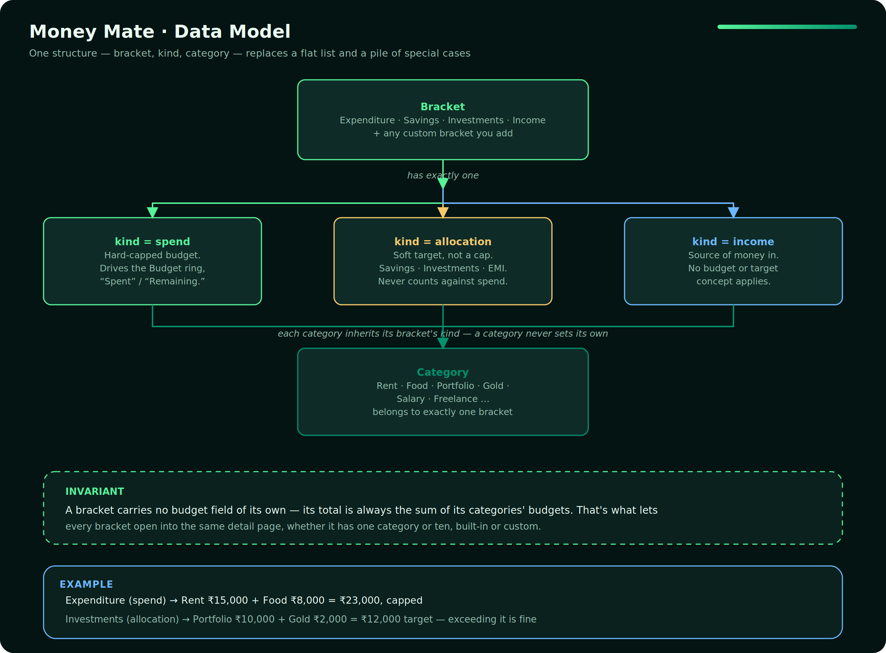
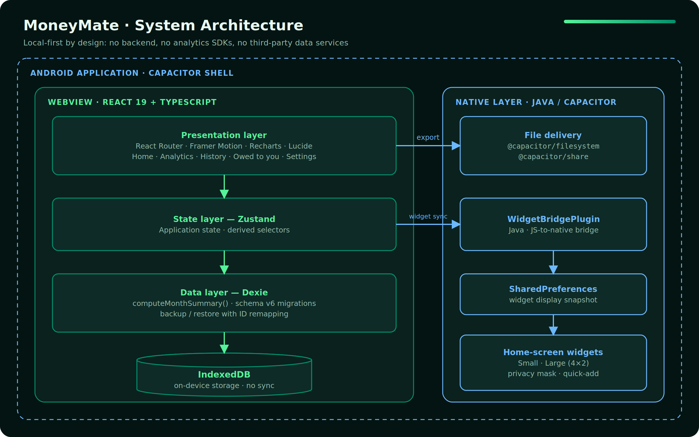
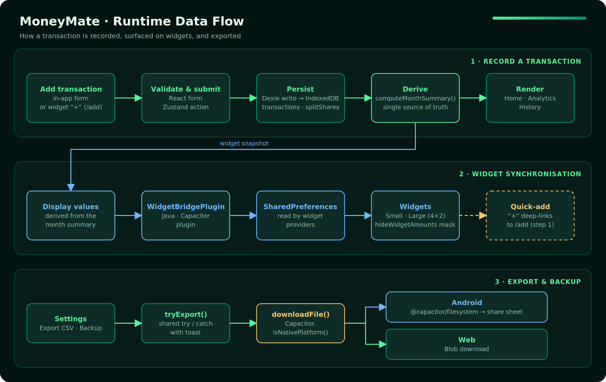

<div align="center">

# MoneyMate

**Privacy-first, fully offline personal finance management for Android.**


-02916D)


**[Try it live →](https://money-mate-mocha.vercel.app/)**

</div>

---

## Overview

MoneyMate is a personal finance application built around a single constraint: **financial data never leaves the device.** There is no account system, no backend, no cloud sync, and no third-party data processor. Every byte of your financial data stays on your device, in your device's own local storage.

The product implements a *pay-yourself-first* budgeting model. Users allocate spending budgets per category up front, record transactions as they occur, and monitor over- and under-budget positions through real-time visual analytics.

## Key Capabilities

**Budgeting**
- Category and subcategory budgets organized into brackets
- Pay-yourself-first allocation model with per-category tracking
- Automatic reduction of catch-all "General" categories when subcategories are added, keeping bracket totals stable

**Transaction Management**
- Fast transaction entry with recurring transaction support
- Month-scoped history with filtering and a month snapshot summary (total spent, income, category breakdown)
- Split-expense tracking: only the user's own share is charged to the category budget; other participants' shares are tracked separately with per-person balances and full or partial settlement

**Analytics**
- Category distribution and trend visualizations
- Month-by-month navigation across historical periods
- Collision-aware pie chart label layout for readability on small displays

**Android Integration**
- Home-screen widgets in compact and large (4×2) variants
- Widget privacy mode that masks monetary amounts
- One-tap quick-add widget action with deep link into the transaction form
- Native file delivery for CSV and backup exports via the system share sheet

**Data Portability**
- Full backup and restore, including split-expense data
- Structured CSV exports designed for downstream BI tooling (see [Data Export and Analytics Integration](#data-export-and-analytics-integration))

## Screens, at a Glance

| Screen | Purpose |
| --- | --- |
| **Home** | Landing screen. Income, and one card per bracket (Expenditure, Savings, Investments, Income, or any custom one) with this month's progress. "Unallocated" — money you haven't given a job to yet — is front and center. |
| **Budget** | Daily-use shortcut: capped spending only, aggregated across every spend-kind bracket. Ring, by-category breakdown, today/daily-average/days-left, recent transactions. |
| **Bracket detail** | One reusable page for any bracket's own categories — Rent/Food under Expenditure, Portfolio/Gold under Investments, Salary/Freelance under Income. Add, edit, archive, or delete categories; rename or archive the bracket itself. |
| **Add transaction** | Log an expense or income entry: amount, category, date, and optional merchant/note. |
| **History** | Full transaction list with search, month filter, category filter, and a calendar-heatmap view. |
| **Insights** | Charts: spend trends, category breakdown, income vs. spend, day-of-week patterns, top merchants, budget vs. actual. |
| **Settings** | Manage brackets, recurring transactions, currency/theme/income preferences, backup & restore, and data exports. |

## Data Model

The whole app is built on a two-level model instead of a flat list of categories:

- **Bracket** — the top-level classification: *Expenditure*, *Savings*, *Investments*, *Income* by default, plus any custom bracket you add (*EMI*, *Work Expenses*, …). Each bracket has a **kind**:
  - `spend` — a capped budget. Only spend-kind brackets drive the Budget screen's ring, "Spent," and "Remaining" figures.
  - `allocation` — a transfer out of income toward a goal (Savings, Investments, EMI…). Has a soft target, not a hard cap, and never counts against the spending cap.
  - `income` — a source of money in. Budget/target is meaningless here.
- **Category** — belongs to exactly one bracket and inherits its kind. Rent and Food live under Expenditure; Portfolio and Gold could live under Investments. A bracket with a single category and a bracket with ten behave identically everywhere — sub-dividing is entirely optional per bracket, never a special case in the code.

A bracket's own total is always the sum of its categories' budgets — a bracket never carries a budget field of its own. That's what lets any bracket open into the same detail page for further breakdown, with no distinction in the code between "the app's built-in categories" and "brackets you added yourself."

<p align="center">
  
</p>

## Architecture

MoneyMate ships as one React core deployed two ways — an installable PWA and a native Android build via Capacitor — with no backend behind either. Native functionality is exposed to the web layer through Capacitor plugins and a project-specific widget bridge.

<p align="center">
  
</p>

**Layering**

| Layer | Responsibility |
| --- | --- |
| **Presentation** | Renders screens, charts, and interactions. Holds no business rules. |
| **State** | Coordinates application state and exposes derived selectors. |
| **Data** | Encapsulates all persistence and budget computation. Schema migrations are versioned and applied on database open. |
| **Native** | Provides file delivery, sharing, and widget synchronization. The widget bridge writes a display snapshot to `SharedPreferences`, which the widget providers read independently of the WebView lifecycle. |

## Runtime Data Flow

<p align="center">
  
</p>

1. **Record a transaction.** Entry originates from the in-app form or the widget quick-add action, which deep-links to `/add`. Input is validated, dispatched through a Zustand action, and persisted through Dexie. Split expenses write the user's share to `transactions` and other participants' shares to `splitShares`. `computeMonthSummary()` then derives all budget figures consumed by the UI.
2. **Synchronize widgets.** Derived display values are handed to `WidgetBridgePlugin`, stored in `SharedPreferences`, and read by the widget providers. When `hideWidgetAmounts` is enabled, monetary values are masked.
3. **Export and backup.** Export handlers are wrapped in a shared `tryExport()` boundary. `downloadFile()` branches on `Capacitor.isNativePlatform()`: Android uses `@capacitor/filesystem` and `@capacitor/share`; the web build uses a blob download.

## Technology Stack

| Area | Technology |
| --- | --- |
| Language | TypeScript |
| UI framework | React 19 |
| Build tooling | Vite, `vite-plugin-pwa` |
| Routing | React Router |
| State management | Zustand |
| Persistence | Dexie (IndexedDB) |
| Charts | Recharts |
| Motion | Framer Motion |
| Icons | Lucide |
| Native runtime | Capacitor (`@capacitor/android`, `@capacitor/filesystem`, `@capacitor/share`) |
| Typography | Fraunces, Plus Jakarta Sans, JetBrains Mono (self-hosted via Fontsource) |
| Testing | Vitest, React Testing Library, jest-axe |
| Linting | oxlint |
| Android build | Gradle, Android Studio |

All fonts are bundled with the application; no runtime requests are made to external font providers.

## Data Model and Persistence

Data is stored in a Dexie-managed IndexedDB database (current schema: **version 6**). Core entities include categories and brackets, transactions, recurring transaction definitions, and `splitShares` for amounts owed by other participants.

Field-level definitions, relationships, and derived-column semantics are documented in [`DATA_SCHEMA.md`](./DATA_SCHEMA.md).

**Backup and restore**

Backups are complete, portable snapshots of all tables. Restore performs identifier remapping so that relationships between transactions, categories, and split shares remain consistent, and explicitly resets auto-increment counters after clearing tables to prevent referential corruption.

**Invariants**

- Only the user's own share of a split expense counts against a category budget.
- Recurring transaction processing validates frequency values before execution.
- Budget figures shown on any screen originate from `computeMonthSummary()`.

## Security and Privacy

- **No remote data path.** The application has no backend and integrates no third-party data services.
- **Signing material is excluded from version control.** Release signing configuration is loaded from a gitignored `keystore.properties`.
- **Widget privacy.** A dedicated setting (`hideWidgetAmounts`) masks monetary values on home-screen widgets.
- **Destructive operations are isolated.** Irreversible actions such as erasing all data are separated into a dedicated danger zone in Settings.
- **Data ownership.** Users can export or fully erase their data at any time without any external dependency.

> Because data resides solely on the device, uninstalling the application removes all records. Users are advised to create a backup before uninstalling or reinstalling.

## Getting Started

### Prerequisites

| Requirement | Version |
| --- | --- |
| Node.js | 20 LTS or later |
| npm | Bundled with Node.js |
| Android Studio | Current stable release |
| JDK | 17 or later (the JBR bundled with Android Studio is sufficient) |
| Android SDK | Installed through Android Studio SDK Manager |

### Installation

```bash
git clone https://github.com/tej-mahender/MoneyMate.git
cd MoneyMate
npm install
```

### Local Development

```bash
npm run dev
```

The development server runs the web build in a browser. Native-only capabilities (file delivery, widgets) are available only on an Android device or emulator.

### Production Web Build

```bash
npm run build
```

## Building for Android

### 1. Synchronize the Web Build

```bash
npm install
npm run build
npx cap sync android
```

### 2. Open the Native Project

```bash
npx cap open android
```

Allow Gradle to complete its initial sync.

### 3. Configure Release Signing

Release signing values are read from `android/keystore.properties`, which **must not be committed**.

Generate a keystore (one-time):

```bash
keytool -genkey -v -keystore moneymate-release.jks \
  -alias moneymate -keyalg RSA -keysize 2048 -validity 10000
```

Create `android/keystore.properties`:

```properties
storeFile=../moneymate-release.jks
storePassword=<store-password>
keyAlias=moneymate
keyPassword=<key-password>
```

> Store the keystore and its credentials in a secure, backed-up location. Losing the signing key makes it impossible to publish in-place updates to existing installations.

### 4. Build the Release APK

From the `android/` directory:

```powershell
.\gradlew.bat assembleRelease
```

On macOS or Linux:

```bash
./gradlew assembleRelease
```

Output:

```
android/app/build/outputs/apk/release/app-release.apk
```

Alternatively, in Android Studio: select the **release** build variant, then **Build → Build Bundle(s) / APK(s) → Build APK(s)**.

### 5. Install

```bash
adb install -r android/app/build/outputs/apk/release/app-release.apk
```

## Data Export and Analytics Integration

MoneyMate produces structured exports intended for external analysis while keeping the data under user control:

| Export | Description |
| --- | --- |
| Fact table | Transaction-level records with foreign keys |
| Dimension tables | Categories, brackets, and related reference data |
| Monthly summary | Aggregated per-month budget and spending figures |
| ML dataset (JSON) | Transaction records with precomputed date features |

Column definitions are specified in [`DATA_SCHEMA.md`](./DATA_SCHEMA.md). On Android, exports are written through `@capacitor/filesystem` and delivered via the system share sheet.

## Project Structure

```
moneymate/
├── android/                 # Capacitor Android project
│   └── app/
│       └── src/main/        # Manifest, resources, widget providers, WidgetBridgePlugin
├── docs/
│   └── images/               # Architecture, data-flow, and release-pipeline diagrams (SVG + PNG)
├── public/                  # Static assets and PWA manifest
├── src/
│   ├── components/          # Shared UI components
│   ├── pages/                # Route-level screens
│   ├── db.ts                 # Dexie schema, migrations, computeMonthSummary()
│   └── ...                   # State, utilities, styles
├── DATA_SCHEMA.md            # Data dictionary
├── capacitor.config.ts       # Capacitor configuration
├── vite.config.ts            # Build configuration
└── package.json
```

## License

Copyright © 2026 Tej. All rights reserved.